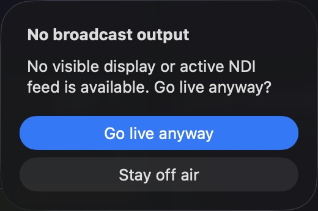
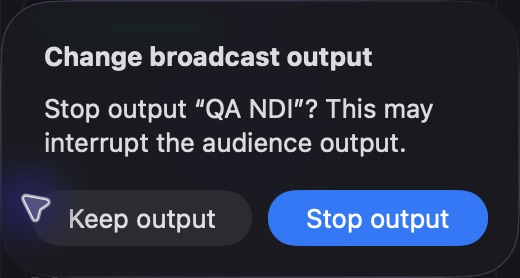
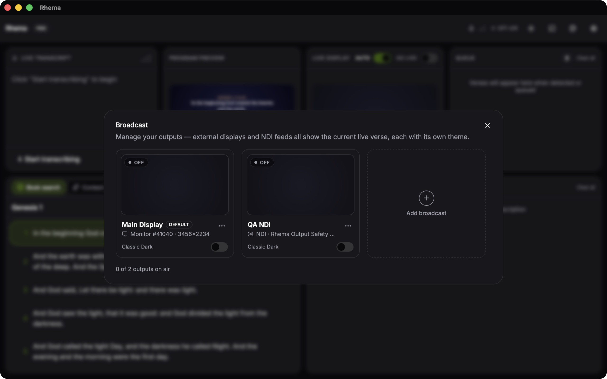

# Broadcast output safety

The app, remote action registry and broadcast compatibility action share one
on-air boundary. It checks configured outputs against visible native windows and
active NDI senders. A hidden renderer alone does not count. If no audience output
is available, a native warning offers **Stay off air** or **Go live anyway**.
Native status errors cannot prove output availability. A later off command,
configuration change or transport operation cancels an obsolete pending request.

Stopping or removing an active output, and changing its transport settings,
requires confirmation. Cancellation preserves the configuration and transport.
Failed native stop/close leaves the configuration available for recovery. The
main output cannot be removed. Concurrent operations are serialized per output;
repeated enables inspect native state and leave an already-active sender alone.
When status is unavailable, enabling also requires confirmation.

Failed starts attempt sender/window cleanup and retain a runtime error on the
card. Startup nudges and status reconciliation carry transport revisions so they
cannot revive a stopped feed. Runtime status is not persisted.

## Verification

32 focused action/lifecycle tests cover fresh availability, hidden renderers,
unknown status, cancelled/confirmed stop/removal/edit, stop failure, configuration
replacement, duplicate triggers, output isolation, delayed startup, stale status
and active-enable idempotence. The full branch passes 291 frontend tests, real
TypeScript checking, lint and production build; both Rust feature configurations
pass 380 tests, alongside strict Clippy and formatting.

A macOS debug package with a separate QA identifier/profile verified the actual
no-output warning, cancellation and explicit confirmation. A disposable real NDI
sender started at 1920×1080/24fps and submitted a first frame. Cancelling stop or
removal retained the active sender; explicit Stop later yielded zero active
outputs while preserving its configuration and leaving Main off. The QA app was
closed. Temporary duplicate QA bundle instances briefly disrupted automation;
they were cleaned up before the final run.

Windows/Linux native UI, physical projector and receiver quality/latency checks
remain required. This change does not establish #177 latency targets. Full
session restoration, presentation refresh and frame scheduling are separate
remediation tasks. If another caller exposes stop during pending startup, add
latest-intent cancellation/queue semantics before using the per-output boundary.

