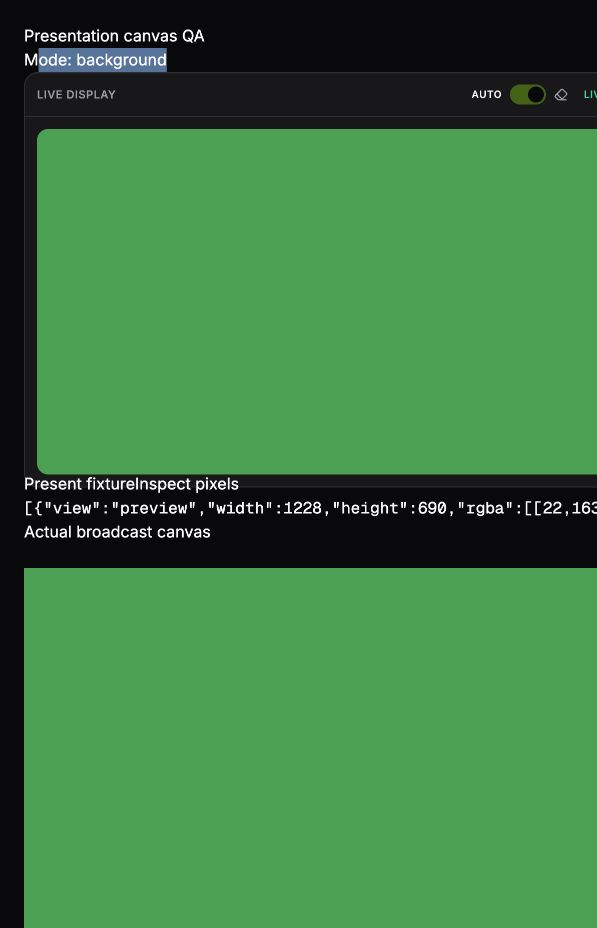
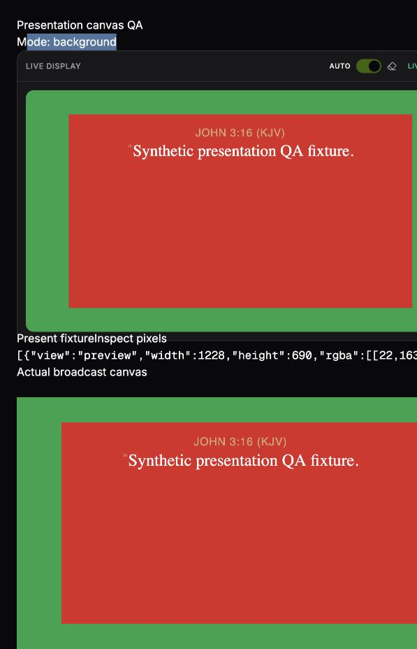

# Presentation and clear controls

A Present action resolves the requested canonical verse in the currently confirmed primary translation. Missing text, a failed lookup, or a row from another reference/translation retains the previous live content and reports an error. Cached candidate text is never substituted for missing primary text.

Presentation requests and translation refresh share one revision gate. A newer Present, Clear, on-air → off-air change, or controller invalidation cancels an older lookup. Changing the confirmed translation refreshes the live reference without moving the browsed preview. The app root owns this refresh subscription, so hiding the Live display panel does not suspend it.

The eraser menu in Live display clears content without closing a display window or stopping NDI:

- **Transparent:** every canvas pixel becomes transparent.
- **Black:** every canvas pixel becomes opaque black.
- **Background only:** the theme background remains, with text plates disabled.

An explicit clear also applies while off air and survives later theme/image/font synchronization. The next successful Present restores normal verse rendering. Each output receives the same clear mode and its own configured theme.

## Verification

Controller tests cover invalid/missing primary text, translation identity agreement, deferred lookup races, pending translation switches, off-air cancellation, cleanup, and per-output clear payloads with no transport stop. Renderer tests cover physical bitmap bounds, alpha/compositing, theme plates and fallback.

A temporary browser harness exercised the actual preview and broadcast canvas components with mocked Tauri boundaries. Corner, center and far-corner samples in both canvases were RGBA `[0,0,0,0]` for Transparent, `[0,0,0,255]` for Black, and `[22,163,74,255]` for Background only with a green theme and red text plate. Presenting afterward restored the red plate `[220,38,38,255]` and verse. This verifies browser rendering, not native NDI receiver behavior.

App-owned detection/transcript/reading subscriptions, independent Follow controls, and session reset integration remain separate work in Task 3 of the remediation plan.
