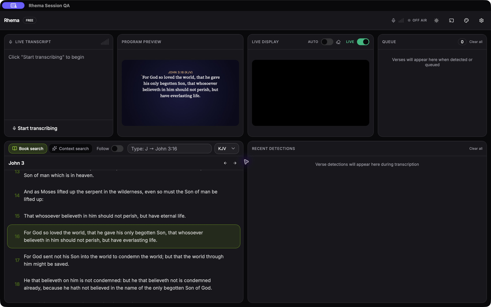

# Session controllers and operator controls

The app root owns transcript, audio lifecycle, detections, reading advances, Bible catalog/bootstrap, navigation, preview translation refresh, remote commands, presentation refresh and output-ready synchronization. Panels consume state and initiate actions. Hiding a panel does not suspend ingestion or remote navigation.

`operatorActions` is the shared UI/remote command registry; `remoteActions` remains a compatibility export. Settings → Display mode and Live display → Auto now change the same state. The old settings-only display flag did not control live presentation. The unsupported cooldown/threshold promises were removed from that display section; saved detection settings remain intact.

| Follow | Auto | Incoming direct detection or reading advance |
| --- | --- | --- |
| Off | Off | Keep manual browsing and live content. |
| Off | On | Present verified primary text; keep browsed verse, chapter and scroll. |
| On | Off | Navigate preview/browsing; retain live content. |
| On | On | Navigate browsing and present verified primary text. |

Follow starts off each app session and appears in the Book search header. It does not change Auto or go on air. Turning Follow off cancels unfinished detection-owned browsing and permanently revokes an in-flight request’s preview permission, including after Follow is re-enabled. Turning Auto off cancels unfinished automatic presentation; re-enabling it waits for a new candidate. Reading advances do not add queue items. Existing backend-marked auto-queue/refinement behavior is preserved separately from these choices.

A manual verse click still presents once. An explicit Present takes preview ownership from unfinished detection browsing. Queue/Add actions retain their existing behavior. Navigation may request a scroll while Follow is enabled, but never moves keyboard focus out of the operator’s input. This also prevents asynchronous reference lookup from interrupting typing. Panel arrow navigation ignores editable targets, composing key events and events already handled by a child. Composing Enter does not submit or clear the reference input.

Only the app controller owns selection refresh; retained chapter rows in a panel cannot overwrite a newly resolved translation. Preview translation refresh has its own cancellation gate, independent of live output: a late response cannot overwrite a newer browsed selection. Missing/wrong-reference results retain preview with its original translation label and report the error. Catalog/bootstrap ignores responses for a previous or unconfirmed translation.

Output-ready callbacks ignore events after disposal, release late listener registrations, and keep at most one delayed paint-sync timer per configured output. They synchronize current content without restarting a transport.

Verification includes policy/race tests and an actual React App mounted under StrictMode with real Transcript and Search panels. Tests unmount both panels, then deliver transcript/detection/reading, remote navigation and output-ready events through the mocked native event boundary; ingestion remains exactly once. Canvas rendering and native receiver acceptance are tracked separately. macOS packaged smoke in a separate QA profile verified Follow toggles, Settings Manual updating Live display Auto, and Black → Off → On retaining cleared live content while preview remained selected.

New-session/archive reset orchestration and native receiver/recorded-sermon acceptance remain in the remediation backlog; no issue is closed by this focused ownership slice alone.
