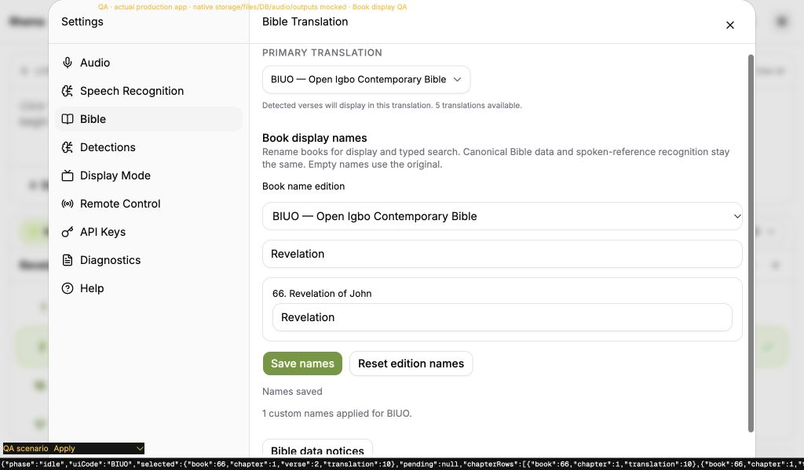
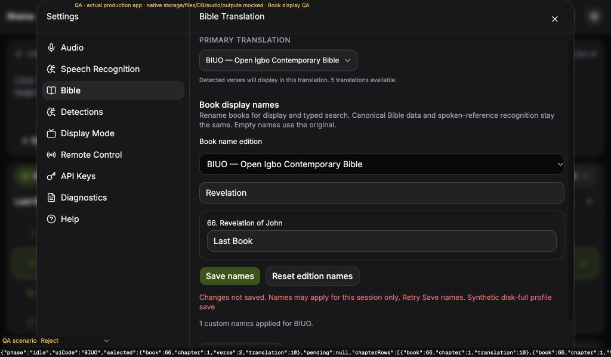
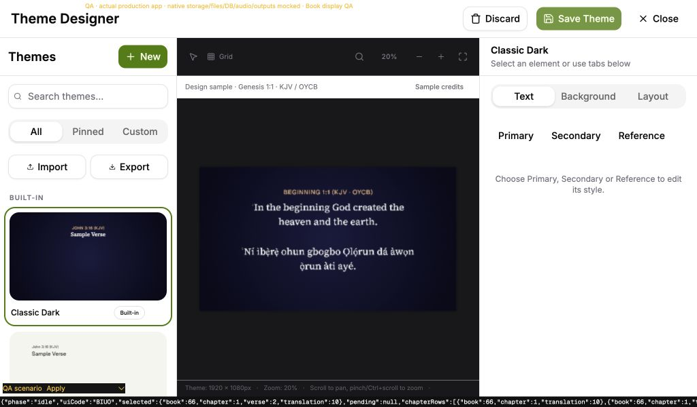

# Editable Bible book display names

This fresh #138 slice builds on our structured-reference draft #206. Bible settings now contains a searchable editable book list with an independent edition picker, Save names and Reset edition names. `Revelation of John` can display as `Revelation`. Clearing a field uses its canonical name. Reset changes the editor first and requires Save names. Other editions and names outside a partial catalog remain intact.

Preferences use stable translation codes and canonical book numbers, never database row IDs. Canonical Bible metadata, lookup coordinates, verse text, speech aliases and detection vocabulary stay intact. The current preview and verified held frame can change their label without a verse lookup, selection change, new presentation intent or on-air toggle. Optional text arriving later uses the latest naming preference. Display-window events and session snapshots carry the resolved label, so output renderers do not need independent settings hydration.

The shared formatter applies labels in single/bilingual measurements and drawing, including the offline designer and library samples. Search headings, accessible verse labels, Queue, detections and Suggestions use display adapters while actions retain canonical identities. Exact canonical names and abbreviations remain searchable; custom typed aliases must be unambiguous. Canonical exact matches take priority over conflicting custom aliases. Unicode and punctuation are supported. Existing unstructured held frames remain verbatim; they gain a structured label on a new verified presentation. Legacy Queue ranges retain their suffix when their canonical book prefix is known; unfamiliar legacy reference strings remain intact. Native detections use their structured coordinates for display.

## Persistence and portable settings

The bounded list accepts at most 6600 unique edition/book pairs, code syntax shared with existing portable editions, books 1–66, and trimmed Unicode names up to 120 UTF-16 units without C0/C1 controls. The frontend normalizes names to NFC. Native restore independently validates lengths, identities, codes and controls before the SQLite transaction. Uninstalled future edition codes remain portable.

Save names publishes the validated preference for the current session, then awaits the existing serialized profile flush. A failed flush explicitly says the changes are **not saved**, may apply only for the session, and can be retried. It does not claim a durable save. Malformed names already in a saved profile latch the existing unreadable-profile guard before attaching save subscriptions, protecting the original data from unrelated writes.

New session and preferences JSON carry the list. Old JSON remains readable without injecting the field during parsing; staged restore explicitly defaults its missing list to empty. Review shows the count and each code/book/name, and explains that an empty restored list returns to canonical names. Mapping an unavailable primary edition does not rewrite unrelated override codes. The native expected-revision transaction, rollback, local credentials, microphone and output bindings retain their existing semantics. Theme JSON carries styling; global book names travel with session/preferences JSON.

Archives capture the visible reference label alongside canonical source book names, numbers and stable edition codes. Manual Queue actions now capture their selected row's source code immediately, including while a different primary selection is pending.

## Automated evidence

- **993 frontend/data tests in 82 files** pass after the one review/fix pass. TypeScript, the intentional type-error detection probe, zero-warning lint and the production build pass. The existing bundle-size advisory remains.
- **479 Rust tests pass in each configuration** on macOS (`cargo test --workspace --locked` and `--no-default-features`); strict workspace/all-target Clippy and format checks pass. No dependency was added.
- Tests first reproduced missing schema, search, formatting, persistence, archive, editor, live-frame and palette behavior. Native restore tests first rejected the unknown field, then passed real SQLite apply/reopen, bounds/duplicate rejection and injected mid-transaction rollback.
- Additional regressions cover partial catalogs, punctuation, old JSON/default restoration, future codes, stale edition responses, unreadable profiles, active maintenance, pending primary/optional text, typed navigation ownership, legacy/numbered labels and manual Queue source attribution. All eight language/layout combinations verify actual formatted drawing and measured width after a custom label.
- The palette assertion was corrected to inspect its actual pending-navigation handoff rather than an immediate preview selection. Initial archive and native failures were retained in temporary test logs. The new editor uses edition/revision-scoped state rather than synchronous effect resets; all lint findings were resolved.

## Independent review and one fix pass

One fresh Astra/high reviewer examined the complete `3769e5a..419066c` branch and retained evidence. There were no Critical findings, two Important findings and one Minor. Both Important findings were independently reproduced before the fixes, then verified in one pass; no second review was dispatched. Exact reviewer token usage and cost are unavailable.

1. Generated input could substitute a display label that reparsed as another canonical book or coordinates. Parsing now stays separate from completion formatting, and generated input falls back to the canonical spelling when a label cannot round-trip through the book-only and complete stages. This does not restrict presentation names. Pure regressions and actual mounted Search tests cover conflicting canonical names, duplicate aliases, `John 3`, `Love3` and `John 3:16`, including typing, IME completion, Tab, ArrowRight and Enter. A colon awaiting its verse correctly has no pending navigation; two initial assertions were corrected to that existing contract.
2. Context results could retain the previous edition's text while acquiring the new edition's display label and Queue source code. Result batches now capture their source ID/code atomically, asynchronous publication rejects another edition, and the panel hides batches whose source is no longer current. Retained callbacks also check source/batch identity before selection, presentation or Queue mutation. A mounted test reproduces an edition change before React removes the old DOM, rejects both old actions, and verifies a replacement ESV result captures its actual ESV text/ID/code.

The focused run passed 166 tests. The entire final frontend suite passed 993; native source was unchanged by this pass, so the 479/479 Rust and strict Clippy/fmt evidence above still applies to the same native source. Additional post-review paths have automated evidence; retained browser screenshots precede this pass.

Deferred Minor: the Suggestions “already queued” toast still uses its canonical reference while the card and successful Queue toast use the custom display name. Action identity and Queue contents remain canonical and correct.

Review rulings, including costs if wrong:

- Keep legacy string-only held frames verbatim because they lack verified identity. Cost: an old frame keeps its old label until the next verified presentation.
- Keep speech aliases and Bible metadata canonical. Cost: a custom display name does not become a spoken recognition alias.
- Keep canonical sample credits and diagnostic references as source identifiers. Cost: those source-credit labels differ from the rendered presentation name.
- Discard unsaved editor drafts on edition change or dialog closure; Save is explicit. Cost: an unsaved edit must be re-entered.
- Retain the specified NFC/control-character naming contract, without extra Unicode restrictions. Cost: a visually confusing label remains possible; unsafe generated input falls back to canonical spelling.
- Keep installed dialogs/restarts, provider audio and physical receivers as separate acceptance work. Cost: this draft remains unverified for those environments; browser mocks cannot establish them.

## Production browser evidence

The [retained fixture](fixtures/book-display-names-browser-fixture.tsx.txt), [HTML](fixtures/book-display-names-browser-fixture.html.txt), [observations](fixtures/book-display-names-browser-observations.json) and screenshots use the actual production main/App, settings, Search, Canvas/Fabric, Queue, session export and restore-review UI at **1024×600**, light/dark. Native profile, Bible data, audio, output/window routes and file dialogs are mocked. The synthetic verse body intentionally mentions the canonical name, making unchanged source text visible.

Observed behavior:

1. The 66-book editor saved BIUO `Revelation`; Search heading, preview and held-frame label changed on canonical book 66, chapter 1, verse 2. The initial five final transcript segments, one Queue entry and one detection stayed intact during this first save.
2. A deliberate page reload retained saved names. The existing volatile-session policy cleared transcript/Queue/detections on reload; this slice does not claim to change that policy. A later manually queued verse stayed the same entry through edits, reset and export.
3. Custom `Revelation` and Unicode `Ìṣípayá — Ọ̀rọ̀` inputs navigated to book 66; the Unicode alias visibly presented verse 17. The original `Revelation of John` input still returned to verse 2.
4. The live Canvas used the renamed label. Editing KJV to `Apocalypse` left the BIUO live frame on its original coordinates/text, with native primary ID 10 unchanged. The QA-only no-output warning was mocked with the plugin's actual button-label receipt; an initial boolean receipt was corrected without production changes. No physical audience output was started.
5. A synthetic disk-full save showed the explicit session-only error; the mock stored names stayed at their prior Unicode value while the session label became `Last Book`. Retrying acknowledged the save. Resetting BIUO removed only its preferences and retained KJV's name; current live/Queue labels returned to canonical names.
6. Light-mode editing saved the requested shortened name again. KJV `Genesis` → `Beginning` appeared in the actual offline bilingual Fabric sample while its canonical sample credit stayed `Genesis 1:1`.
7. Both portable JSON exports reopened in the readonly archive. Preferences listed all three code/book/name mappings. Full session JSON showed the renamed Queue label and unchanged canonical source text. Restore review listed the mappings and disabled Apply while on air; Cancel left the session unchanged. Local key/unknown-field/monitor receipts remained retained, and exports excluded the fake key.

One expected `[settings] Failed to persist settings` warning came from the injected disk-full case; no unexpected warnings/errors were observed. Inherited QA receipt flags named `hasQueue`/`hasTranscript` look for earlier sentinel strings, not generic counts; the reopened session UI explicitly established the new one-entry Queue. Browser artifacts precede the final manual-Queue attribution and numbered-reference compatibility assertions; those additions have automated evidence.

The temporary fixture files, Vite entry, local server, tab and viewport override were removed. Installed-platform persistence/dialogs, real provider audio, native input-method ordering and physical receivers remain separate acceptance work. No original issue or PR is closed by this draft.
