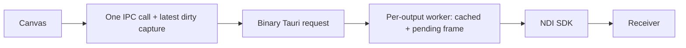

# Broadcast frame delivery and receiver evidence

This fresh implementation addresses the application-side risks in #177. The issue stays open: Windows/vMix baseline, complete operator-to-receiver latency and supported-platform receiver acceptance are not established by these local results. Idle fade (#179) remains deferred until that gate passes.

## Delivery contract

The renderer retains one in-flight binary IPC call and one latest dirty capture. It reads pixels only when a revision can be submitted. Completing a slow call immediately drains the newest dirty revision; a transient failure retries after 100 ms. Stop cancels queued capture/retry work. Unchanged frames no longer cross IPC as full-resolution base64 bursts or keepalives.

Native negotiation returns a session generation and renderer lease. Compare-and-swap epoch claims reject late handshakes. A renderer reload can start at revision one while obsolete leases and older revisions are rejected. The native worker owns one cached bitmap and one pending replacement per output, repeats the cache at the selected cadence, and joins its synchronous SDK call before destroying the sender. Cached RGBA→BGRA conversion is reused until the content key changes. The SDK metadata advertises the selected integer rate exactly: 24/1, 30/1 or 60/1. [NDI frame-type specification](https://docs.ndi.video/all/developing-with-ndi/sdk/frame-types).

Tauri's raw request body carries RGBA bytes with bounded metadata headers. Only the matching `broadcast-{output}` window can claim or submit that output. Frame dimensions and byte counts must match the active configuration. The binary handoff uses the documented [Tauri raw request API](https://v2.tauri.app/develop/calling-rust/).



Transparent/black/background are content changes with newer frame revisions. A stale frame cannot replace a newer clear inside this delivery boundary. A new explicit presentation may replace clear. Stopped/restarted sessions reject obsolete packets. Arbitrary reordering of upstream Tauri verse-update events is not certified by this transport boundary. No actual upstream reordering was established during review; retain that end-to-end acceptance check.

## Reload and teardown ownership

A reloaded output renderer negotiates its lease but submits no placeholder frame. Its last valid native bitmap stays on air until an authoritative presentation arrives. The main webview synchronously snapshots its presentation/source, manual/Auto state, clear mode, output configuration, current themes and designer draft before fanout. This uses same-webview `sessionStorage`, with a version/checksum and a native process discriminator; a fresh native process never restores old on-air content. Disk preference hydration cannot overwrite the newer session snapshot. Storage failure removes an older snapshot so it cannot restore stale content.

Before rendering the operator controls, startup inspects surviving windows and native senders and reconciles actual transport status. Root listeners inspect once more after registration, closing the inspection/registration gap; native start/stop completion notifies the current main window even if the original caller was destroyed. Delayed status responses cannot overwrite newer responses. Missing/corrupt recovery with surviving output shows an unknown preview and holds existing content. Explicit Clear establishes known content; an active sender without a renderer must be stopped in Settings before Clear/presentation can proceed. Orphan output IDs remain available in Settings for stopping. Packaged reload/window destruction behavior still needs platform acceptance.

Stop/restart revokes intent and detaches an output under the short registry lock. Its own operation lock serializes retiring old senders, creating replacements and committing only the current intent. SDK join/destruction runs outside the registry on a blocking task; a stalled output therefore does not block another output's native content/clear submission. Stops also revoke unfinished creation. A bounded single SDK library is retained for the native runtime lifetime, preventing a last-sender destroy racing another output's initialize. An SDK stall can still delay that output's teardown or shutdown.

## Trace and telemetry

A trace ID links accepted presentation intent (including reserved intent before chapter lookup), verse resolution, output event, canvas render, native IPC receipt and SDK completion. Webviews, Rust and the local receiver record epoch milliseconds from the same host clock. SDK call duration uses Rust `Instant` only within the native process. Never subtract unrelated monotonic origins. Negative/nonfinite wall-clock differences invalidate a measured run. Forward wall-clock jumps are not automatically detected; retain stable host-clock conditions. SDK completion is not receiver appearance.

`get_ndi_status` returns session/protocol metadata and counters for submission, coalescing, duplicate/rejected packets, SDK sends, cached repeats, last content key, send duration and error. Normal stop writes a final counter snapshot to diagnostics. The SDK synchronous send function has no delivery acknowledgment; `active` and `sent` do not prove audience reception.

## Verification

Mounted production-renderer regressions failed against the previous implementation: overlapping pushes discarded the newest clear, and a late mount-status reply reactivated a stopped renderer. Both pass with the new path, including raw byte submission, no unchanged IPC sends and timer cleanup. Pure tests exercise 100-update coalescing, retry, stop, replacement leases, stale revision rejection and independent outputs. Native worker tests cover cached cadence, blocked sends, stop/join, output isolation, lease CAS and exact rate metadata. Packet parser tests exercise invalid/missing/overflow metadata, dimensions, bytes and trace IDs.

Fresh whole-branch review identified reload divergence, premature placeholder delivery, metadata-only probe validation and global-lock teardown coupling. One fix pass added reload/corrupt-cache/process-restart/unsaved-config regressions, native-start completion after main reload, orphan renderer handling, frozen-pixel rejection and runtime-level blocked-stop/revoked-creation tests. Controlled clock math checks 24/30/60 scheduling across wakeups and stalls. All 394 frontend tests, typecheck, lint and build pass; all 394 workspace Rust tests pass with default and no-default features, with strict Clippy and formatting.

A trace test also failed before correction because an upstream 500 ms chapter lookup was omitted from accepted-intent timing. Reserved intent now carries the original trace through presentation.

## Local SDK receiver probe

Actual local sender and receiver on macOS Apple Silicon (Apple M2 Max), optimized sender build, ten warmup changes and 100 measured changes per output at a 100 ms input interval. Eight wide black/white bars encode each revision in independently sampled pixels. The analyzer checks all eight RGBA samples with codec tolerance, matching generation/renderer epoch, dimensions and exact rate metadata. A frozen bitmap with fresh metadata fails. These samples establish pattern identity, not full text/image correctness or RGB channel/compositing fidelity. This directly calls the native runtime and **excludes operator dispatch, lookup, event fanout, canvas rendering, pixel capture, IPC, projector display and Windows/vMix**. It is receiver smoke for this native boundary, not the issue's end-to-end target proof.

| Configuration | Output | Received | p50 | p95 | p99 | Final clear |
| --- | --- | --- | --- | --- | --- | --- |
| 720p, 30 fps, straight alpha, one output | qa-0 | 100/100 | 25 ms | 42 ms | 46 ms | Transparent |
| 720p, 24 fps, opaque, one output | qa-0 | 100/100 | 28 ms | 50 ms | 53 ms | Opaque black |
| 1080p, 60 fps, alpha-preserving mode, two outputs | qa-0 | 100/100 | 22 ms | 42 ms | 60 ms | Transparent |
| 1080p, 60 fps, alpha-preserving mode, two outputs | qa-1 | 100/100 | 24 ms | 42 ms | 55 ms | Transparent |

All observed rate metadata matched its selected rate. The completed runs captured final clear and no older frame afterward. They also exercised runtime restart generation rejection, replacement revision-one acceptance and final stop. They do not establish receiver reconnection after restart.

Sampled peak sender CPU/RSS was 25.6%/30.1 MiB for 720p30, 22.4%/30.2 MiB for 720p24 and 109.1%/73.4 MiB for two-output 1080p60. macOS CPU percentages are per logical core. These short native-only observations are not production app budgets or long-session memory guarantees. Receiver peaks, per-change timestamp pairs, observed pattern bytes, dimensions/session identities, counters, OS version and executable/SDK hashes are in [the evidence JSON](fixtures/native-ndi-local-results.json).

The same patterned workload was also run with a debug sender. Both 720p runs received 100/100 changes. Each two-output 1080p60 receiver received 97/100: each native pump reported three coalesced updates, all received patterns were correct, and both final clears arrived. Sender peak CPU was 201.1%. Those runs are retained with `valid: false`, missing revision IDs and counters; their percentiles do not represent a complete 100-change benchmark. Optimized runs used the identical 100 ms input interval and had zero coalescing. No builds overlapped measured patterned runs.

The earlier uniform-pixel, metadata-only measurements at commit `debe713` are superseded and retained in Git history; they cannot establish per-change visual delivery. An earlier 25-second receiver truncation is likewise excluded. The receiver now waits for five terminal frames with a 45-second cap. The analyzer exits nonzero for missing samples, mismatched patterns/session/dimensions, incorrect clear, stale frames after clear, wrong rate metadata or negative/nonfinite clock differences. All completed patterned sender/receiver processes exited successfully, including the debug runs whose missing samples the analyzer correctly rejected.

Canvas readback is straight RGBA; NDI BGRA is also specified as straight. The probe used the existing `premultiplied` setting for the two-output run, preserving alpha without adding RGB premultiplication. Receiver color/compositing behavior across all applications/modes still needs acceptance.

## Reproduce the native-boundary probe

Prepare the official SDK through the repository setup. Build the Rust example before starting the receiver's discovery timeout:

```sh
cargo build --release --manifest-path src-tauri/Cargo.toml -p rhema-broadcast --example ndi_frame_probe --locked
clang++ -std=c++17 -I sdk/ndi/include scripts/ndi-frame-receiver.cpp \
  -L sdk/ndi/macos -lndi -Wl,-rpath,"$PWD/sdk/ndi/macos" -o /tmp/rhema-ndi-receiver
```

In separate terminals, start the receiver and then the sender with the same unique source prefix:

```sh
/tmp/rhema-ndi-receiver Rhema-QA-Probe-0 > /tmp/received.jsonl
```

```sh
src-tauri/target/release/examples/ndi_frame_probe 30 720 Rhema-QA-Probe 1 straight > /tmp/submitted.jsonl
bun scripts/analyze-ndi-probe.ts /tmp/submitted.jsonl /tmp/received.jsonl qa-0 0 30
```

For two outputs, start receivers matching suffixes `-0` and `-1`, use sender count `2`, and analyze each file with its output ID. Receiver compilation/library paths differ on Windows/Linux. Only synthetic pixels are used; no app profile, microphone or API key is needed. These are local test processes and exit automatically.

## Remaining acceptance matrix

Capture a 100-change baseline from the pre-change app on the documented Windows/vMix setup, then repeat the actual integrated app head: visible and hidden renderer; one/two outputs; 720p/1080p; 24/30/60 fps; supported alpha modes; projector and NDI separately. Use an external/common recorder or synchronized clocks for receiver appearance, and preserve per-revision measurements, coalesced/dropped counts, CPU/RSS and configuration. Targets after warmup are p95 ≤250 ms and p99 ≤500 ms with no stale final frame. Retain receiver buffering configuration and investigate its contribution.

Also verify packaged binary IPC on all supported platforms, theme/image/font completion, clear/stop during in-flight work, reload/reconnect, upstream event ordering and cross-branch integration. Native SDK calls can still block shutdown if the SDK itself stalls; bounded provider teardown and physical receivers are not inferred from mocks. No idle-fade behavior or OMT adapter is introduced here.
