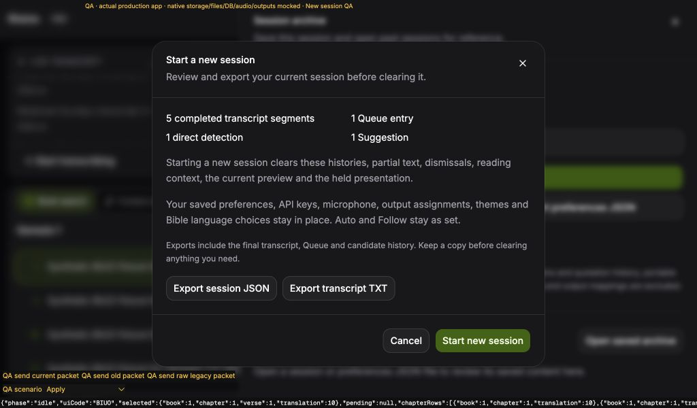
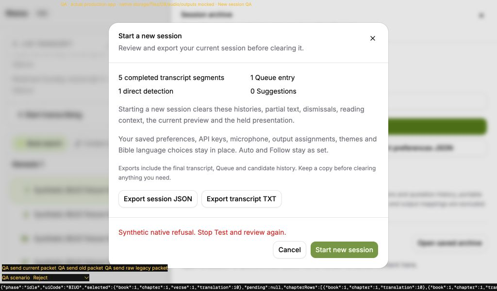
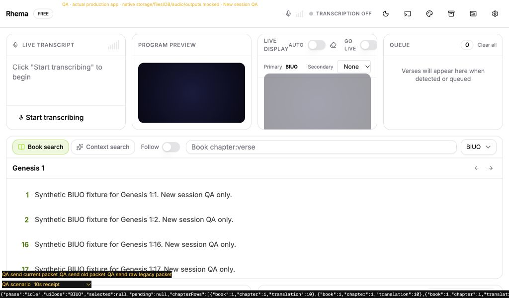
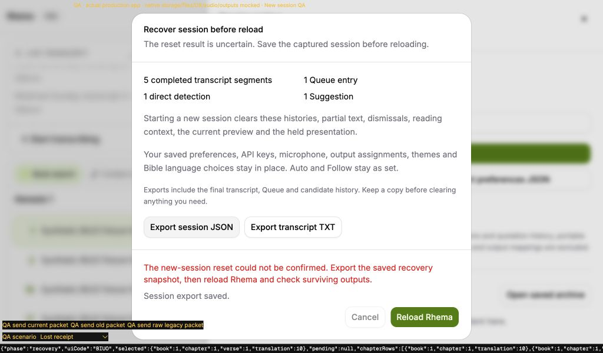

# Explicit New session

Fresh implementation on our session-boundary draft #208. No original PR implementation was copied, and no original PR or issue was closed. The Session archive panel now offers an explicit review/export/clear action for #140 and the remaining reset scope of our #192.

## Behavior and failure boundary

The review lists completed transcript segments, Queue entries, direct detections and Suggestions. It explains that partial text, dismissals, native reading context, selected preview and held presentation also clear. JSON and TXT exports are independent; cancelling or failing an export never dispatches reset. Cancel, Escape and outside dismissal before reset preserve the session.

Reset requires stopped transcription, Live off, no pending provider or audio start, no audio test/capture, no Theme Designer, no output or translation change, readable preferences, ready presentation recovery and no other maintenance. It does not stop the microphone or outputs to force these conditions. A synchronous maintenance lease invalidates existing app work before any await. All three legitimate preference queues drain with `Promise.allSettled`; conditions are rechecked after the drains and native revision bootstrap.

A detached validated archive is captured before invoking native reset. The old broadcast snapshot is removed before dispatch. Only an exact successor receipt advances the frontend revision and clears its stores. A known refusal carrying the unchanged revision keeps histories and the held frame and rewrites the old snapshot. A stale refusal, malformed/unmatched receipt, transport failure or post-ack publication exception holds Recovery and removes the snapshot. There is no automatic second reset. Recovery exports use the captured archive even if publication partially cleared active stores; Reload is explicit.

On success the app clears transcript/partial/status, candidate histories and dismissals, Queue/active/highlight/timer, preview/pending navigation/search/context/cross-references, audio meter/source-loss and live verse/source/trace. It publishes an explicit off-air background clear and synchronizes every configured output. Saved settings, local keys/device/output identities, theme objects, edition choices and Auto/Follow policy remain. Bible catalog and browsing chapter remain, with automatic preview seeding suppressed until a new selection.

Remote events now use the same tagged session envelope as native transcript/detection events; legacy raw emissions remain available to compatible consumers. Old packets delivered to a new listener are refused. Audio-test meter and terminal emissions retain their originating revision and acquire the native session boundary before emitting either route, fixing the deferred #208 meter finding. Existing per-audio-test-run behavior remains separate from the logical new-session boundary.

Retained Suggestions, detection and Queue controls carry the rendering revision; controls rendered during maintenance remain invalid after release. Queue presentation also resolves the current index from the row identity. Search rejects stale pointer, input, composition and keyboard events before child controls can acquire a fresh intent. A UI reset revision remounts the locally frozen Suggestions snapshot.

## Automated verification

Before independent review: 1,038 frontend tests in 89 files; TypeScript, the intentional type-error probe, lint with zero warnings and production build pass. Both native configurations pass 489 tests each on macOS; strict workspace/all-target Clippy and formatting pass. Final native tests were rerun after extracting the audio claim helper. The clean build was rerun after removing the temporary QA entry.

Regression failures were observed before the associated changes: controller reset/recovery, audio preparation, candidate completion and frozen controls, remote packets delivered to a new listener, Queue identity and retained controls, controls rendered while busy, retained Search rows and native originating audio ownership. Two initial fixture mistakes (JSX in a `.ts` test and leaked Queue contents) were corrected before assessing the Search failures; both then failed on actual stale selection. A registration-cleanup test now waits for registration to begin before unmounting, since revision bootstrap precedes listeners.

The focused run passes 130 tests across 11 files. Actual App controllers with panels absent reject old saved callbacks, packets delivered to replacement listeners, overlapping candidate/native detection/presentation/chapter completions, then accept a current-session packet. Controller tests cover all preconditions, single dispatch, delayed receipt, known refusal, stale/malformed/lost receipts, saving failure before dispatch, unchanged preference/local identities, cleared output fanout and partial-publication recovery. Mounted dialog tests cover focus, review/cancel, export cancellation/failure, busy controls/Escape/duplicates, refusal, reactive preconditions and Recovery exports/reload. Actual JSON/TXT recovery export tests clear current UI first and verify captured Unicode content with partial text and local key excluded.

The exploratory `--all-features` Clippy run also enabled the unchanged optional `search_bench` binary and reported five existing lints there, alongside three new audio helper lints. The new helper lints were fixed. The required workspace/all-target gate passes; the optional benchmark findings remain tooling follow-up. This is not an all-features success claim.

## Production browser evidence

The retained fixture loads the production `main` and App, actual Canvas rendering and production dialog/controller. Native storage, files, Bible data, provider/audio and physical outputs are mocked. It cannot establish installed-native acceptance. Both tabs used 1024 × 600; temporary entry files, server, tabs and viewport override were removed.

- Review showed five final segments, one Queue entry, one direct detection and one Suggestion, with the footer visible in dark mode. JSON and TXT saved; each excluded partial text and the fake local key. Cancellation, cancelled export and failed export left histories and frame intact with zero reset calls. Suggestions later expired through their normal retention policy; this was not a reset.
- A known native refusal in light mode retained five segments, one Queue item, two retained detection records, partial text and the held BIUO frame at revision 7. Its native reset-call count was one.
- A 10-second receipt held old content under `committing`, disabled export/Cancel/apply, removed the inner Close button and ignored Escape. After its exact acknowledgement, all runtime histories and preview/frame were empty, edition BIUO, gain 1.6, Auto/Follow false, custom theme count one, monitor 2, fake local key and unknown local preference remained. Profile writes were the three required flushes, not restored/replaced preferences.
- Old revision and raw legacy packets left the cleared session empty. A current revision-8 packet then produced one transcript segment, one detection and one Queue item. Starting mock transcription made the review refuse reset with Stop transcription guidance; mock transcription was stopped afterwards.
- A separate fresh fixture simulated native commit to revision 8 followed by a lost receipt. Recovery kept the pre-reset five segments and Queue item, disabled Cancel, offered no second Start, and exported both captured formats without partial text or the fake key. Explicit reload bootstrapped revision 8, empty volatile histories and retained preferences. Ordinary cold-bootstrap chapter selection remains as before.

Eight JavaScript mock callback warnings occurred while emitting old packets after two maintenance cycles; no console errors occurred. This is the previously documented Tauri mock `eventId`/`id` unlisten mismatch from #208. No dependency or production workaround was added. Recovery had no warnings or errors. Injected export/refusal/lost-ack errors were shown in product UI. Browser evidence precedes the independent review; later review fixes will be identified separately.

Raw observations and the synthetic fixture are under `fixtures/new-session-*`.

## Design rulings and costs

1. Keep New session in the existing Session archive panel, with explicit product confirmation. Cost: one extra navigation step; no new permanent dashboard panel.
2. Keep the browsing chapter but clear selected preview/program and suppress automatic seeding during this webview session. Cost: prior chapter rows remain visible; ordinary reload uses existing cold-bootstrap selection.
3. Capture a detached archive before native dispatch. Cost: bounded duplication in memory; invalid current export data refuses reset until corrected rather than silently losing it.
4. Freeze Recovery for uncertain receipts or publication failure. Cost: the operator must export/reload and inspect surviving outputs; partially published UI cannot be rolled back reliably after native reset.
5. Keep stopped/off-air prerequisites and require pending native jobs to settle. Cost: reset cannot be used as an emergency stop or to force past a wedged invocation.
6. Preserve local preferences and output transports while clearing their content. Cost: background/theme remains visible and existing sender resources stay allocated.
7. Preserve raw event compatibility while main consumes tagged events. Cost: duplicate bounded native emission; unrecognized raw consumers remain outside main-controller guarantees.
8. Treat a remote command dispatched by the native sink after reset as new explicit input. Cost: a network request not yet dispatched cannot be identified as old intent without a client generation token; HTTP/OSC wire protocols are unchanged.
9. Invalidate retained controls, including a render during maintenance. Cost: a click in the narrow transition before React's new commit is discarded and may need repeating.
10. Keep installed three-OS dialog/restart, real provider/audio, output receiver and Windows/vMix acceptance separate. Cost: mocks and unit tests do not establish those environments. No real microphone, provider, server or output was started for this slice.
11. Keep optional benchmark lints and unrelated roadmap slices separate. Cost: the exploratory all-features gate remains failing until tooling follow-up; this draft does not claim whole-backlog completion.

## Independent review

One fresh Astra/high reviewer examined the complete `5ff6fb3..a44d26a` branch and adjacent contracts/evidence. There were no Critical findings, one Important finding and no additional actionable Minor findings. The Important finding was reproduced and fixed in one test-first pass; no re-review was dispatched. Exact review token usage/cost is unavailable.

The pending transcription start/stop flags were not observable by the readiness hook. After a delayed Stop completed or Start failed, the controller's predicate was ready but the mounted consumer could retain the same blocked reason indefinitely. Both mounted regressions failed before the fix. Start/stop now notify subscribers when their pending promises are installed or cleared, including rejection; readiness subscribes to these transitions. Both regressions and 34 focused transcription/reset/dialog tests pass. Final full verification passes 1,040 frontend tests in 90 files, TypeScript, its intentional-error probe, zero-warning lint and production build. Native source is unchanged from the verified 489-tests-per-configuration, strict Clippy/fmt run. These notification paths have automated evidence after the retained browser screenshots.

Review ruling: use a dedicated pending-operation notifier alongside the existing deduplication promises, rather than adding a second source of truth for pending state. Cost: future changes to these promise transitions must retain notifications; the mounted tests cover completion and failed admission. All design rulings above remain explicit, including separate installed/provider/physical acceptance and the optional benchmark lint follow-up. The #208 originating audio-meter finding is fixed in this branch; the inherited canonical-label “already queued” Suggestions toast inconsistency remains deferred from #207.
