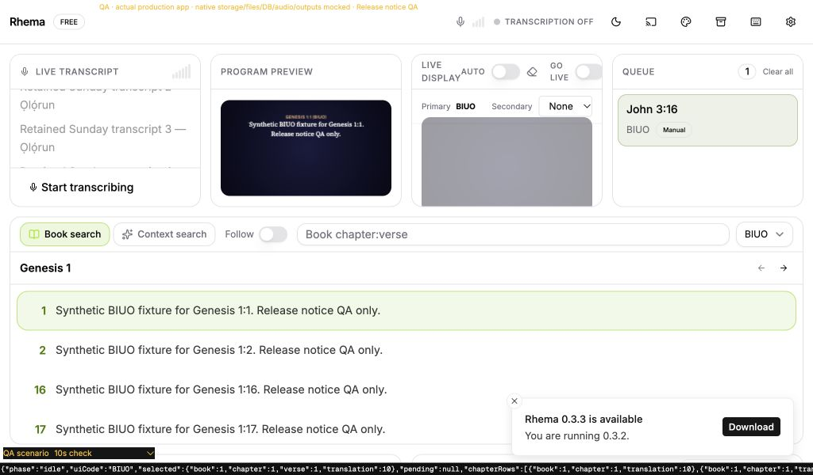
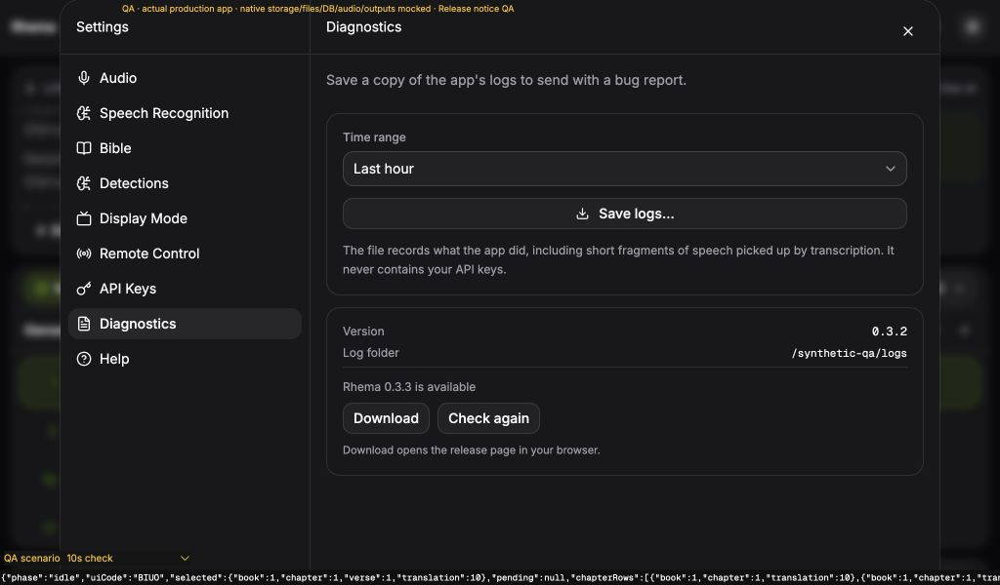
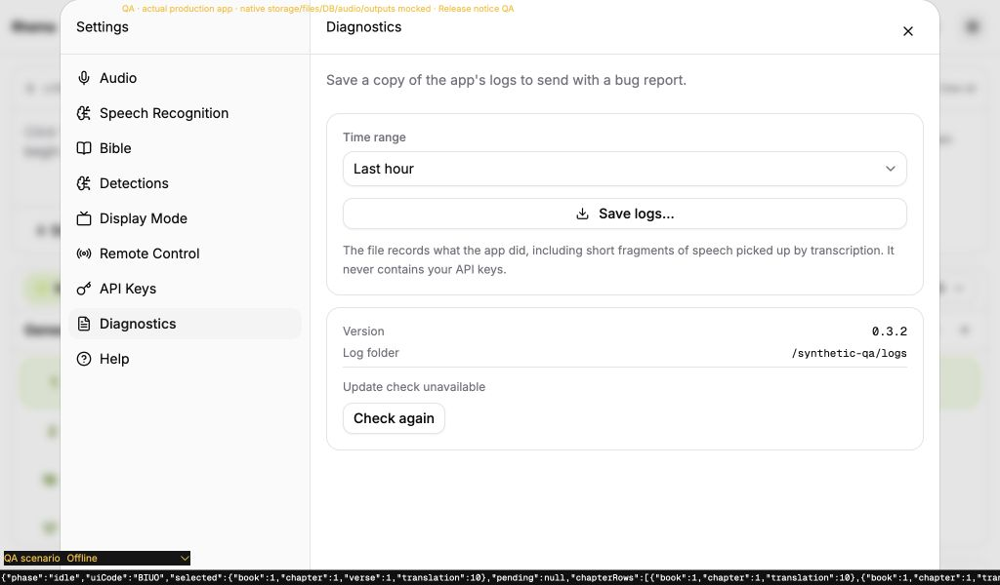

# Startup release notice

Fresh replacement for the notice requirements of original #174, built on our #209. No original implementation was copied, original issue/PR closed, release published, or app version changed.

## Behavior

App startup and Settings → Diagnostics share one initial request and one in-flight promise. A newer stable release produces one dismissible 10-second toast with Download. Diagnostics retains available/current/unavailable status, Download when applicable and explicit Check again. Settings remounts and React StrictMode do not repeat the request or toast. Native process state caches the initial result and claims the notice once, including across a main-webview reload. Explicit retries update Diagnostics without another startup toast. Background failures remain silent; only an explicitly clicked Download can produce an opener error toast.

Rust requests the fixed public GitHub latest-release endpoint with a three-second connection timeout, eight-second total request timeout, no redirects and HTTPS only. It bounds declared and streamed response bodies to 64 KiB, rejects API/transport/JSON/version errors and requires explicit false draft/prerelease flags. Stable three-component SemVer comparison is numeric; prerelease/build/ragged/unknown tags do not prompt. The release link is derived from the validated tag and fixed repository, ignoring any API `html_url`. The [official latest-release contract](https://docs.github.com/en/rest/releases/releases#get-the-latest-release) and the existing locked reqwest/semver APIs were inspected.

The [official opener plugin](https://tauri.app/plugin/opener/) is pinned to Rust 2.5.3, matching the existing JavaScript package. Its actual versioned source was inspected. Automatic interception of unrelated links is disabled. A separate main-window capability allows only `https://github.com/openbezal/rhema/releases/tag/*`; it grants neither default opener permissions nor path opening. Both custom notice commands independently reject non-main windows. The webview CSP, signing/entitlements, microphone declarations and app versions are unchanged. The lockfile adds 45 dependency packages for the opener/features without removing or changing baseline package versions.

## Verification before independent review

The full frontend suite passes 1,053 tests in 92 files. Thirteen focused tests cover initial/in-flight sharing, retries, silent offline/malformed results, native launch claim, explicit Download/opener failure, actual mounted Diagnostics transitions, Settings remounts and combined App/Diagnostics effects under StrictMode. TypeScript, its deliberate-error guard, zero-warning lint and production build pass.

Both native configurations pass 496 tests each on macOS; strict locked workspace/all-target Clippy and formatting pass. Seven new native tests cover main-window admission, stable comparison/link derivation, malformed flags/tags/payload bounds, shared initial cache/explicit retry/one claim, real local HTTP errors/malformed/truncated/oversized bodies, redirect refusal with destination-request counting, and configured timeout against a stalled local response. Each local server is aborted and joined after its test. The tests for new parsing/cache/command interfaces preceded their implementation; network cases were added against the initial client implementation. Initial frontend missing-module failures and mounted-row behavior failures are recorded. A helper sentence shown without an available Download action was removed after the mounted current-state test caught it. Initial Clippy found an unnecessary raw-string delimiter and unfulfilled expectations; both were fixed without lint suppression.

A temporary headless Rust probe included the actual production module and contacted the public release API. At the checked time its v0.3.2 response was 20,905 bytes with ten assets, below the cap. The real configured current version 0.3.2 returned `current` in 1,264 ms. A separate synthetic older input 0.0.0 returned the validated v0.3.2 release link in 970 ms. App metadata and published releases were unchanged. The temporary probe's unused-cache warnings were confined to the probe; required production Clippy is clean. This establishes actual HTTPS/parsing, not installed Tauri command delivery or a physical browser launch. Probe source and results are retained under `fixtures/`.

## Production browser evidence

The production main/App, actual Canvas rendering, notice hook and Settings dialog were exercised at 1024 × 600 in light and dark modes. Storage/files/Bible/audio/provider/outputs/release responses and opener are mocked. Synthetic 0.3.3 is fixture data, not a published release.

- The first immediate toast expired during initial cold browser observation. A second fixture delayed its initial response; the actual production toast was then observed with “Rhema 0.3.3 is available”, current 0.3.2 and Download. No production toast timeout was altered.
- Opening Diagnostics reused the existing single check/claim. Download recorded only the verified release URL after clicking. Five transcript segments, one Queue item, held BIUO frame and local preference identities remained. Normal Suggestions expiry continued independently.
- Explicit retries changed status to Up to date, then Update check unavailable. Neither generated an extra toast. Download disappeared when unavailable/current. A deliberately failed opener showed the actionable error only after clicking Download.
- Main-webview reload retained the synthetic native claim and produced no duplicate toast. A separate offline startup path made one check, zero claims and no toast. The existing reload policy cleared volatile histories while preserving the held frame; this is not a notice side effect.
- Both tabs had zero console warnings and errors. The temporary QA entry, server, tabs and viewport override were removed; a clean production lint/build was rerun.

Installed three-OS current/newer visible acceptance, actual scoped opener enforcement and system-browser opening remain pending. No real microphone, provider, output or user profile was used. No fake release was published and no app version was temporarily lowered.

## Design rulings and costs

1. Deliver a notice and release-page action with explicit download by the operator. Cost: installation remains manual.
2. Cache the initial result for the process; refresh only on explicit retry. Cost: a release published later in a long-running service is not discovered automatically.
3. Claim one startup notice per process, shared across webview reload. Cost: later versions found in the same launch appear in Diagnostics without a second startup toast.
4. Keep failures silent outside Diagnostics. Cost: offline operators must open Diagnostics to see that the check was unavailable.
5. Accept only stable three-component SemVer, ignoring prerelease/build/unknown/ragged formats. Cost: unconventional or prerelease installations/releases cannot receive this notice until a stable-compatible version is used.
6. Refuse redirects and responses beyond 64 KiB. Cost: a future API redirect or large release payload becomes unavailable rather than widening the network/body boundary automatically.
7. Derive links from validated tags and scope the opener to the repository release path in main. Cost: alternate release hosting needs a reviewed code/capability change.
8. Pin the existing JavaScript opener's matching Rust release and disable automatic link interception. Cost: dependency updates and unrelated links remain separate work; Linux receives its upstream opener dependency graph.
9. Use deterministic browser/native unit evidence and a real headless HTTPS probe, retaining installed GUI/receiver/provider acceptance separately. Cost: these checks cannot establish installed native permissions or real system-browser interaction.

## Independent review

Pending one fresh whole-branch review and one test-first fix pass. No re-review is planned; exact review usage/cost is recorded only if available.
