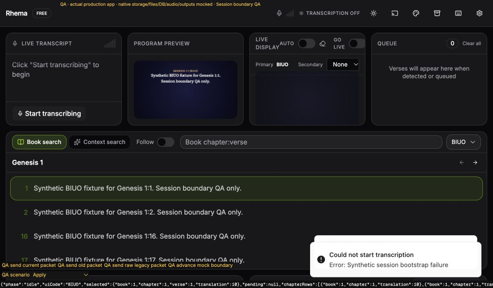

# Native session-reset and event ownership foundation

This fresh slice builds on our book-name draft #207. It supplies the native boundary required by the explicit new-session workflow for #140 and the session-reset part of #192. The review/export/clear dialog is the next slice; this branch does not advertise a user-facing reset as complete.

## Native contract

The process owns a monotonic session revision. Only the main operator window can read it or invoke `reset_operator_session(expectedRevision)`. A reset returns either `{status: "reset", revision}` or a known `{status: "rejected", message}`; an invoke failure is not proof of rejection. The upcoming UI must retain its old session and enter recovery on uncertain acknowledgement, and publish its clear only after validating the exact successor revision.

Reset holds the existing session boundary against start, stop and active worker mutations. It refuses active transcription, an audio test, a stale revision or exhausted safe-integer range. It acquires AppState and every direct/reading/merger/pipeline lock before changing any component. A poisoned final lock therefore leaves prior context intact. Successful reset clears direct context, reading state and cooldowns in both detection paths, preserves configured merger policy and loaded semantic resources, then advances the revision. Stopped maintenance also invalidates provider preparation already in flight. No profile section, Bible source data, API key, microphone selection or output assignment is changed.

Manual `detect_verses` work uses the same boundary and an optional expected session revision. The actual helper is tested with two threads: reset waits for admitted work, advances only afterward, and rejects a queued old revision before its action can mutate context. Existing legacy callers may omit the revision; the frontend always supplies its acknowledged one and drops obsolete returned results after maintenance.

The audio-test active flag is claimed while holding AppState, so reset cannot pass between checking the test and publishing its active flag. No test opens a real microphone.

## Event admission

STT transcript, detection, reading, translation, connection/error, source-loss and meter events now have a `session:<existing-name>` route carrying `{revision, payload}`. Emission stays inside the existing native run-token boundary. Audio-test events also use this emitter. Existing raw routes remain for compatible consumers, including the separate Test meter; the main ingestion controller subscribes only to tagged routes.

A fresh main webview reads the native revision before admitting packets. Bootstrap is shared and fails closed; transcription start waits for it. An unreadable revision produces restart guidance and never falls back to raw events. Acknowledged reset accepts only the exact successor. Mismatched, old, unacknowledged or untagged packets cannot populate transcript, Queue, detections or navigation, even if delivered to a newly registered listener after maintenance or reload. Existing cancelled-handler, delayed-registration, StrictMode and shared-controller lease behavior is retained.

The revision is process-local and cached only in the current webview. It is not a persistent session archive, provider run identity or credential. Ordinary stop/restart retains the same logical operator session; an explicit new-session reset advances it.

## Automated evidence

The final gate results are retained in `fixtures/session-reset-boundary-results.json`. Tests first failed on the missing reset method/module, native reset primitives, tagged ingestion, provider bootstrap and manual detection guards. Later regressions first reproduced obsolete manual results escaping through the return value and the missing manual-work/reset serialization helper. They pass with the final implementations.

Native checks cover reset/refusal/repeated reset, canonical context/reading/cooldown cleanup, policy preservation, safe revision bounds, exact envelope serialization, poisoned-lock atomicity, operator-window restrictions and actual two-thread ordering. A drop-counted loaded embedder/index remains alive and searchable after reset; this verifies resource retention without pretending to run a real model/provider. Existing native start/reserved-start cancellation tests remain part of the full workspace suites.

Frontend tests cover shared/invalid/retry bootstrap, exact acknowledged advancement, old/current/raw packets, provider waiting/refusal, manual detection dispatch and completion across maintenance, hidden panels, late subscriptions and duplicate starts. Existing maintenance and keyboard fixtures now acknowledge the additional native bootstrap. Strict Clippy required a documentation fix and a targeted Tauri extractor annotation; no lint was disabled globally.

## Production App browser evidence

The [fixture](fixtures/session-boundary-browser-fixture.tsx.txt), [HTML](fixtures/session-boundary-browser-fixture.html.txt), [observations](fixtures/session-boundary-browser-observations.json) and two screenshots exercise the actual production main/App at 1024×600, dark mode. Profile, Bible, native command receipts, audio, windows/output and files are mocked. QA controls emit packets and advance a mock acknowledged boundary; these controls are not the pending production reset UI and deliberately do not clear current histories.

- Initial bootstrap reads mock native revision 7. A current packet adds one transcript, detection and Queue entry; revision 6 and raw legacy packets add none. The held frame, manual selection, local bindings and saved preferences stay unchanged.
- The QA boundary advances to 8 under the real frontend maintenance lease and revision acknowledgement. A revision-7 packet delivered to the replacement listener adds nothing; revision 8 adds the next current entry.
- Reload initializes the new main webview from mock native revision 8. The existing volatile-history reload policy clears transcript/Queue/detections; revision 7 stays rejected and revision 8 starts the new histories. The prior held-frame reload behavior remains unchanged by this foundation.
- An injected bootstrap failure displays Session unavailable; current packets cannot ingest. Clicking the actual Start transcribing control retries the revision read, displays Could not start transcription, and never calls the mock provider start.

Four callback-ID warnings came from the installed Tauri JavaScript mock during maintenance/reload simulation. Inspection confirmed that `event.js` sends `eventId` to unlisten while `mocks.js` removes `args.id`; the mock retains IDs after unregistering their callbacks. The warnings and timing are retained, with no production workaround or dependency edit. Other console errors were not observed; the deliberate bootstrap failures are visible UI errors. Final obsolete-return and native serialization additions have automated evidence after these screenshots.

The temporary fixture files, Vite entry, local server, browser tab and viewport override were removed. Actual installed native event delivery, provider audio and physical receivers remain separate acceptance work. No original issue or PR is closed.

## Design rulings

- Split this native/event foundation from the explicit destructive UI action so both can be reviewed in focused branches. Cost: one additional dependent draft; the user-facing reset remains outstanding.
- Preserve raw channels while main ingestion consumes only tagged channels. Cost: duplicate serialization/emission at the existing bounded event cadence.
- Keep process revision separate from provider run identity and archive persistence. Cost: ordinary stop/restart does not create a fresh operator session; the explicit reset action is required.
