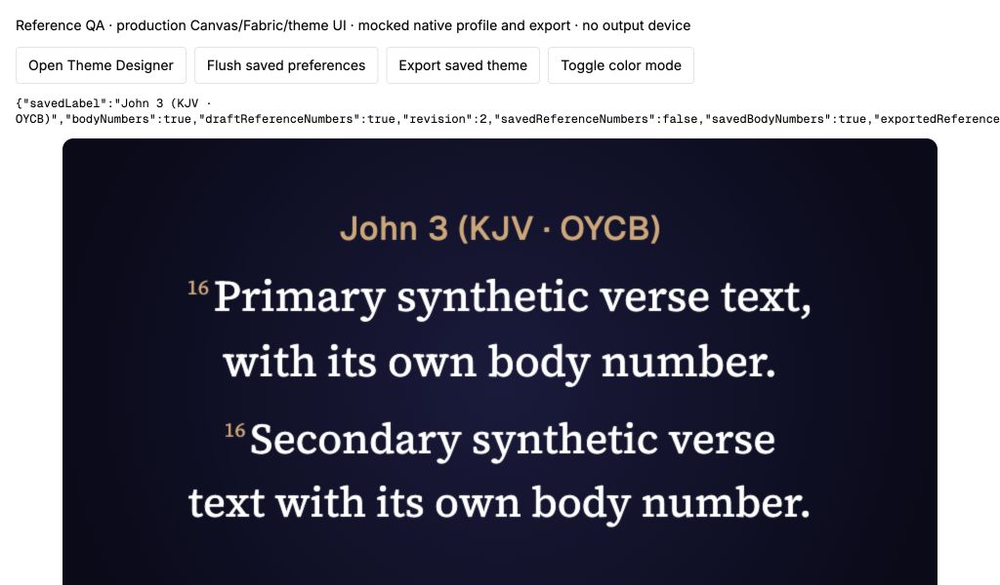
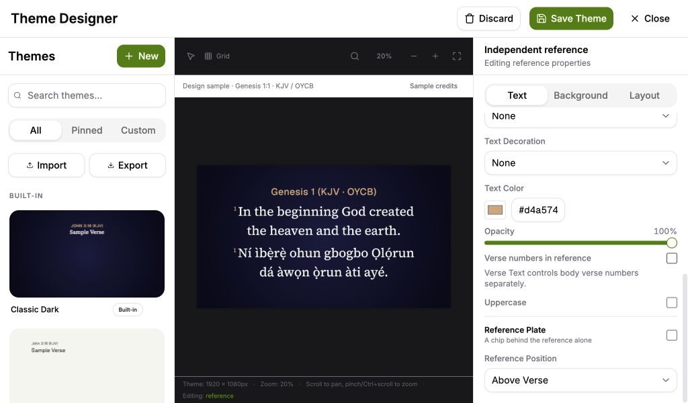
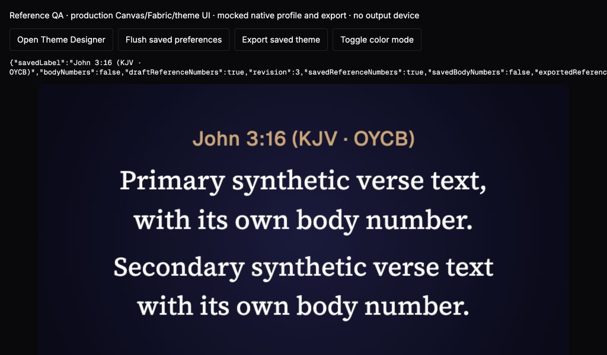

# Independent reference verse numbers

This fresh #138 slice builds on our Bible search intent draft #205. Reference Text has a **Verse numbers in reference** checkbox. With it off, `John 3:16 (KJV · OYCB)` draws as `John 3 (KJV · OYCB)`. The existing Verse Text number setting controls the numbers in both verse bodies independently. A separate panel is unnecessary: the two controls belong to their existing Reference Text and Verse Text sections.

Verified presentation and preview payloads carry an optional structured address alongside the full legacy reference string. One pure formatter supplies the reference for single/bilingual measurements and drawing in above, below, inline and free layouts. Translation attribution and numbered or Unicode book names remain intact. Offline designer and library samples carry addresses too. Native output receives already rendered pixels; display-window events and session snapshots retain the complete render payload.

Themes without the option include verse numbers by default. Explicit false values survive profile hydration, theme JSON export/import, session JSON and portable preferences JSON. The archive schema accepts an optional boolean without injecting a new field into older documents. Native themes remain opaque JSON; this slice changes no Rust source or dependencies.

Old render payloads containing only a reference string remain verbatim. The formatter never guesses a book/chapter/verse by stripping numbers from that string. Such a held frame gains the new display behavior on the next verified presentation; an old string-only frame is not silently rewritten. Book display overrides are a subsequent #138 slice.

## Automated evidence

The tests first reproduced the absent control, unchanged rendered references, missing builder address, legacy-default behavior and dropped archive option. An initial archive assertion used `themes` instead of the existing `customThemes` field; that fixture was corrected before confirming the actual schema loss. The bilingual designer expectation also uses its established OYCB code.

- All **928 tests in 79 files** pass, including 110 focused formatter, renderer, mounted-property, verified-presentation, migration, file and archive tests.
- The renderer recorder observes actual body fragments and reference `fillText` calls, independently in all eight combinations of language count and layout; shortened reference geometry also matches drawing. Turning body numbers off keeps the full reference.
- TypeScript, the deliberate type-error detection probe, zero-warning lint and the production build pass. The existing production bundle size advisory remains.
- #204's 476-test default and no-default macOS native runs are inherited evidence, not rerun claims for this frontend-only change. Cross-platform CI is checked separately on the draft.

## Browser evidence

The retained [fixture source](fixtures/structured-reference-browser-fixture.tsx.txt), [HTML](fixtures/structured-reference-browser-fixture.html.txt) and [observations](fixtures/structured-reference-browser-observations.json) use the production theme designer, fonts, Fabric, Canvas renderer and profile facade in a production Vite build. Only native profile/file/window behavior is mocked. At 1024×600:

1. The initial frame showed `John 3:16 (KJV · OYCB)` and body 16 in both languages.
2. Disabling the production Reference Text checkbox changed the offline designer to `Genesis 1 (KJV · OYCB)` while both body numbers remained.
3. Save Theme, profile flush and mock export retained reference=false/body=true. The saved frame showed `John 3 (KJV · OYCB)`.
4. Reload and reopening in dark mode retained the unchecked reference option.
5. Re-enabling reference numbers, disabling the independent Primary Verse Numbers control, saving and using the production Theme Library Export produced reference=true/body=false. The frame retained `John 3:16 (KJV · OYCB)` without either body number.

No warning or error logs were observed. The temporary fixture entry, files, local server, tab and viewport override were removed after recording evidence. The reference control is reachable by scrolling the existing properties section at minimum size; Save Theme and Close remain fixed in the top bar.

These browser checks establish the real rendering and UI behavior with mocked native boundaries. Installed-platform dialogs, native profile restart, physical output receivers and provider audio remain separate acceptance work. No original issue or PR is closed by this draft.

## Whole-branch review

One fresh Astra/high reviewer examined source commit `f891fd5`. One Important finding: selecting secondary **None** removed the secondary body and legacy label immediately but left its code in the structured address. A pending, null or rejected replacement primary lookup could therefore retain incorrect translation attribution on the held frame. Three controller lifecycle regressions reproduced this before the single fix pass. The immediate transition now copies the address and removes the optional code together with the secondary body; the previous frame remains unchanged. Tests assert both full and chapter-only labels immediately, after null/rejected lookups and in the emitted output payload. No second review was requested. These additional lifecycle paths have automated evidence; the browser artifacts precede this fix.

The review set aside book display editing (next slice), new structured ranges/expanded canon (current verified model is one verse/66 books; old range strings remain intact), and installed-platform/provider/physical acceptance (separate integration work). All three boundaries are accepted explicitly; none is claimed complete here. No Critical or Minor findings were reported. Exact reviewer token and monetary usage were unavailable.
