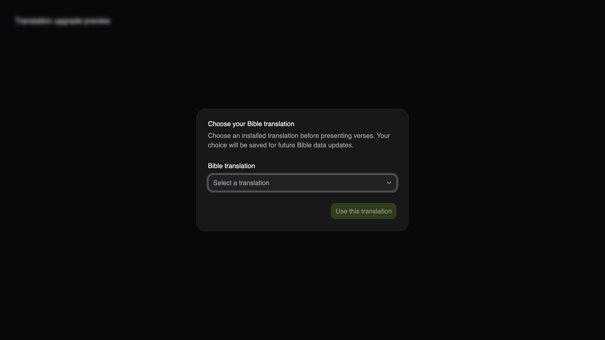
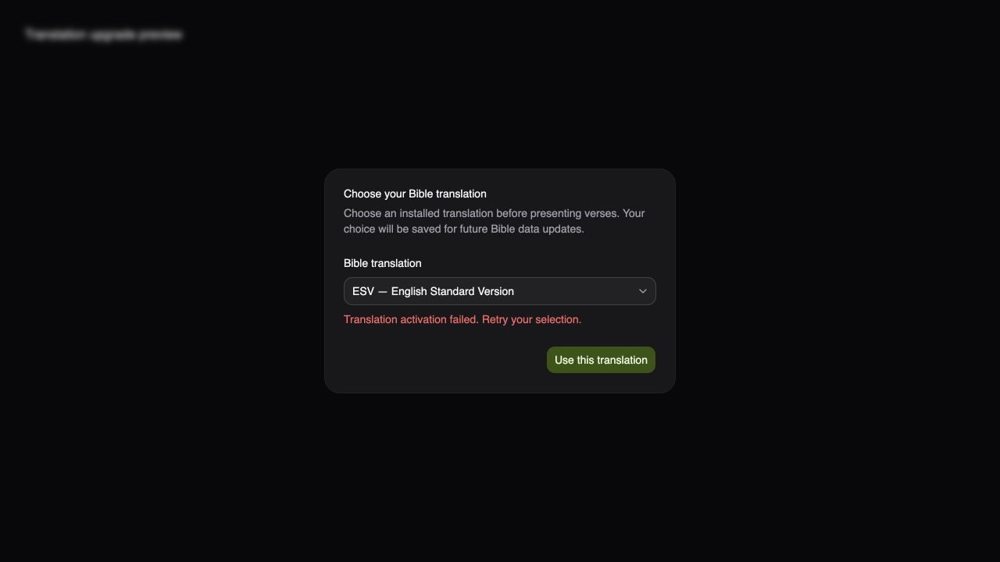

# Bible translation preferences

New preferences identify a translation by its abbreviation, such as `KJV` or `ESV`.
The application resolves that code against the installed Bible database on launch.
Adding another Bible or rebuilding the database can therefore change numeric IDs
without changing a saved choice.

`bible.json` stores a `translationSelection` object with `version: 1`, a `code`, and
the current `catalog` mapping of codes to IDs for provenance. The catalog is never
used to infer a language from an old numeric ID. The legacy `activeTranslationId`
key is removed after a confirmed choice is saved.

Hydration reads the fixed preference file through a native checked command, because
the store plugin suppresses errors during its initial load. A genuinely absent file
is distinguished from an existing corrupt, unreadable, or invalid JSON file.

If an older preference contains only a numeric ID, or its saved translation is no
longer installed, choose an installed Bible in the selection dialog. Presentation
waits for a confirmed selection. An unreadable preference file also requires a
choice; it is not treated as a new installation. A fresh installation selects the
installed KJV by code. If KJV is absent, it asks instead of silently choosing
another Bible.

If Bible data cannot load, the app leaves setup accessible and offers Retry.
Failed backend activation keeps the dialog open. Preferences are saved after a
short debounce, and disk writes are serialized so an older save cannot overwrite
a newer choice.

## Verification

Automated tests cover changed KJV/ESV/NIV IDs, added/absent optional translations,
ambiguous old IDs, unsupported saved formats, unreadable preferences, unavailable
metadata, activation failure, cancelled debounces and slow ordered writes.
Presentation tests verify that an unresolved choice cannot change live output.

The dialog was exercised in a browser using Tauri's IPC mock at the external
boundary. This verifies selection, disabled confirmation and error recovery UI;
it does not replace a packaged upgrade test with real `bible.json` and database
resources on macOS, Windows and Linux.

