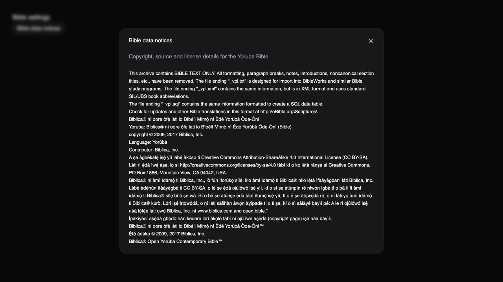
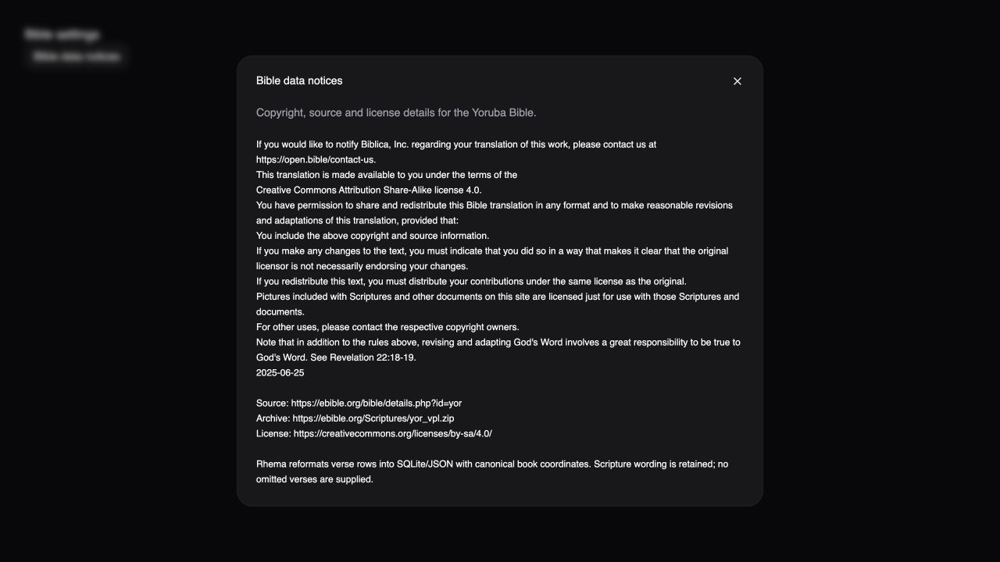
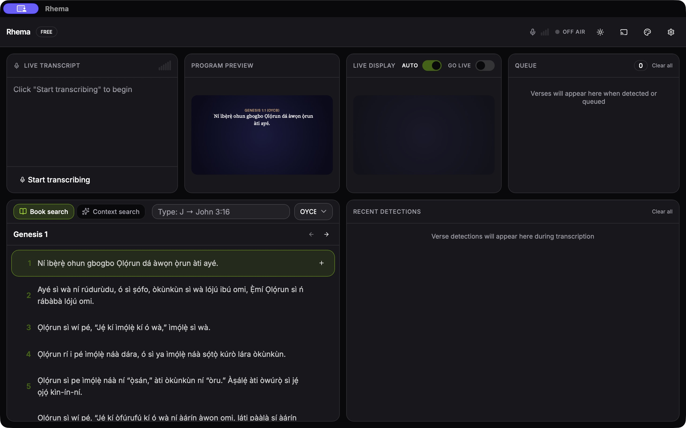
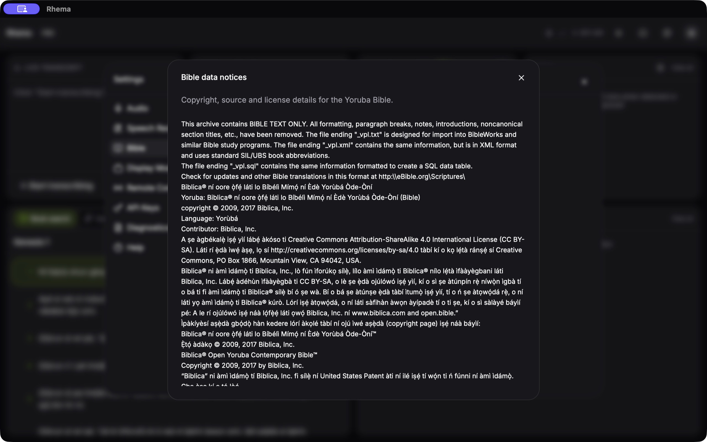

# Yoruba Bible data and safe rebuilds

The independent OYCB pipeline uses the official eBible VPL distribution of the
Biblica® Open Yoruba Contemporary Bible™. `data/yoruba-source.json` records the
source date, archive/VPL/conversion SHA-256 hashes, expected 66 books and 31,087
verses, and license/source URLs. A changed download is rejected until its version
is reviewed. Converted text preserves wording, Unicode and verse coordinates;
missing verse numbers are not filled.

Both `setup:all` and `setup:bundle` now always verify required Bible sources, then
compare a content manifest stored inside SQLite. They rebuild when sources,
translation metadata, schema or the pinned Yoruba specification change. This
handles an existing DB whose source set predates OYCB. An identical rerun leaves
the DB alone. The costly model phases remain controlled by the existing options.

Run only Bible setup with either entrypoint:

```sh
bun run data/prepare-embeddings.ts --bible-only
bun run data/ci-build.ts --bible-only
```

`--data-dir DIRECTORY` directs Bible input/output to an isolated directory for
verification. Both require the existing archive extraction utility, `unzip`.
Build data while Rhema is closed, then restart it to use the new database.

A rebuild writes a temporary database, validates it, closes it and replaces the
old file only after success. Failed downloads or invalid source JSON leave the
working database intact. Explicit canonical book numbers protect partial sources. Legacy sources resolve
canonical names, including Roman numeral prefixes, instead of array positions;
unknown names without explicit coordinates are rejected.
Existing English sources' empty omission placeholders are retained so their
lookup semantics stay unchanged. Yoruba source rows must contain text.

Complete copyright/source/license notices are available offline from
Settings → Bible → Bible data notices. The notice, original archive about file
and source specification are included as Tauri bundle resources. These source
notices accompany the data; Hausa and Igbo remain separate work under #106.

## Evidence and remaining acceptance

Regression tests use real Bun SQLite/CLI with isolated synthetic sources, plus
controlled download/extraction boundaries. A full local source run covered a
seven-translation DB upgraded to eight with OYCB, a fresh build, and both setup
entrypoints. Warm and fresh OYCB queries each returned 66 books/31,087 verses;
an unchanged rerun preserved the exact DB SHA-256. The primary checkout's DB
was not changed.

Browser QA verified the actual offline notice, scrolling to the source/license
footer while retaining the close button, and Escape dismissal. A macOS debug
`.app` built with a separate QA identifier included the database and all three
notice/source resources with matching hashes. In that isolated profile, corrupt
preferences remained untouched until explicit confirmation, Yoruba Genesis 1:1
rendered in preview, the offline notice opened, and OYCB survived a native restart.
The normal application profile was not changed. Windows/Linux installed-bundle
checks and signed release acceptance are still required before release.






